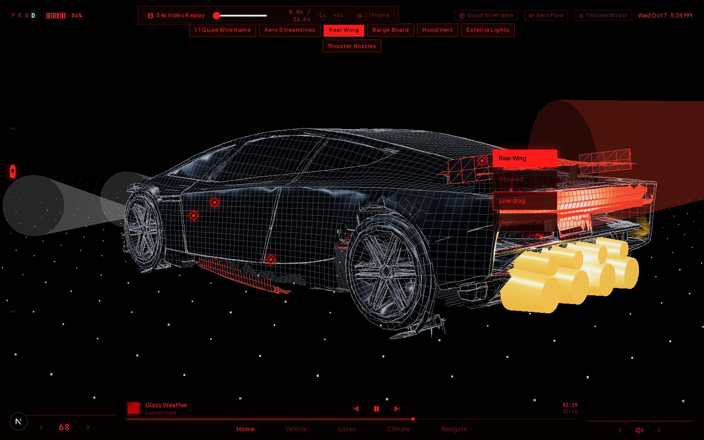
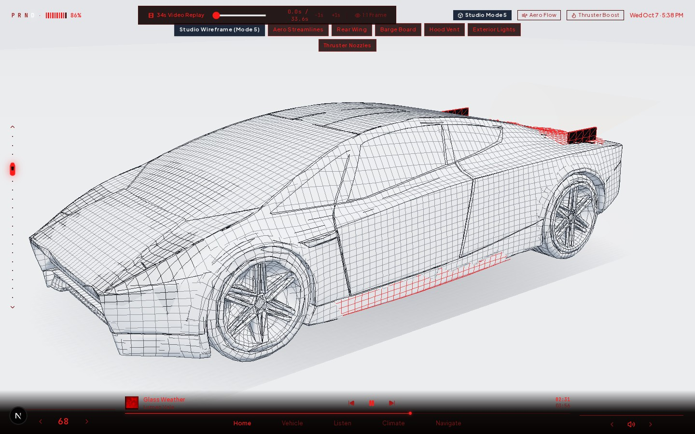

# Tesla Roadster Cockpit Interface

An attempt to recreate the Next-Gen Tesla Roadster's fighter-jet cockpit HUD as an interactive web app — built entirely in [Google AI Studio](https://aistudio.google.com/) using Argon.

**Source video:** [Tesla Roadster Interface Showcase](https://www.youtube.com/watch?v=fdFyXTdJPLA)

> ⚠️ **This is a work in progress.** The AI-generated output is a rough first pass — the car model is not accurate, animations need significant work, and the HUD is far from matching the original. See [What Needs Work](#what-needs-work) below.




## How It Was Built

This project was generated in Google AI Studio (Argon) by giving it:
- The YouTube link to Tesla's Roadster interface showcase video
- A 3D car model ([Tesla Volador](https://sketchfab.com/3d-models/tesla-volador-8d5da3904e434fc3830edf558cb9014d) from Sketchfab)

The AI produced the entire codebase — all ~6,600 lines of it — including the Three.js 3D renderer, state management, animation cue sheets, and UI components.

## Features (Current State)

- **3D WebGL Roadster** rendered with Three.js in two modes:
  - Cockpit dual-pass (dark metallic + crimson wireframe overlay)
  - Studio quad-wireframe (white cyclorama + charcoal wireframe)
- **Active aerodynamics controls** — rear wing (stowed/low drag/high downforce), front splitter, barge boards, hood vent
- **SpaceX cold-gas thruster simulation** — COPV pressure vessel, boost firing with plume effects
- **Track Mode console** — telemetry dashboard, G-force meter, circuit map, lap data
- **Golden X-ray cutaways** — battery pack, COPV tank, suspension, motors
- **34-second video replay** — frame-synced showcase with audio
- **Music player, climate, and navigation views**

## What Needs Work

This was a first-pass AI generation. It's not good — a lot needs to be done:

- **Car model** — The Tesla Volador model is a rough stand-in, not an accurate Roadster replica. The proportions, panel lines, and details are off.
- **Animations** — Transitions are choppy, camera movements don't match the source video, aero surface articulations need smoothing and timing work.
- **HUD accuracy** — The interface layout, typography, spacing, and color values don't match the original video frame-for-frame. Many UI elements are approximations.
- **Performance** — The dual-pass rendering and particle effects are not optimized.
- **Mobile** — Barely functional on smaller screens.

## Tech Stack

| | |
|---|---|
| Framework | Next.js 15 |
| Language | TypeScript |
| 3D | Three.js |
| Animation | Motion (Framer Motion) |
| Styling | Tailwind CSS v4 |
| Icons | Lucide React |
| Platform | Google AI Studio (Argon) |

## Getting Started

```bash
# Install dependencies
bun install
# or
npm install

# Run dev server
bun dev
# or
npm run dev
```

Open [http://localhost:3000](http://localhost:3000).

## Project Structure

```
app/              → Next.js app router (layout + entry page)
components/
  CockpitShell.tsx          → Main orchestrator, state, nav, media dock
  RoadsterCanvas3D.tsx      → Three.js WebGL renderer, all 3D logic
  VehicleOverlays.tsx       → Vehicle sub-tab UIs (dynamics, lights, etc.)
  TrackModeConsole.tsx       → Track mode dashboard + telemetry
  ListenAndAuxiliaryViews.tsx → Music, climate, navigation views
hooks/            → React hooks (mobile breakpoint)
lib/
  roadster-state.ts         → State types, initial state, video cue sheet
  roadster-state.test.ts    → Tests
public/
  models/         → 3D model assets (GLB, textures, wireframe data)
  assets/roadster/ → Reference frames, album art, audio
```

## Disclaimer

This is a fan project for educational purposes. Not affiliated with Tesla, Inc. Reference frames and audio are from Tesla's public YouTube video. The 3D model is sourced from Sketchfab under its original license.

## License

MIT
